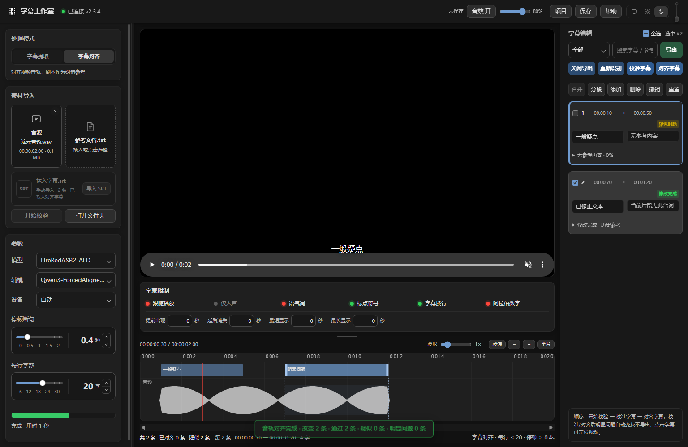

# 开发记录

按日期倒序记录每轮开发：目标、实现步骤、验证结果和详细报告。当前问题与待办见 [问题与待办.md](问题与待办.md)，测试证据原件在 [修复验证/](../../修复验证)。

命名约定：轮次目录为 `修复验证/<主题>_<YYYY-MM-DD>/`，报告统一为 `实现报告.md`，证据为 `后端回归.json`、`后端回归日志.txt`、`前端回归.json`、`浏览器验证.json` 和 `界面_*.png`。无日期目录（`黑白蓝_UI`、`全文参考校验`）是早期留存，只读。

## 项目最终界面

2026-11-09 的界面截图来自隔离测试站点（合成音轨、模拟识别），顶部版本为 2.3.4；工具栏为“校准字幕 / 对齐字幕”，包含语气词红色标签、三色校验和校验报告弹窗。修改过程中的工具栏迭代图、波形对比图和徽标草图不再写入文档。

---

## 2026-11-09 源码运行、环境配置与便携构建分离（当前）

**目标**：将当前目录作为长期维护的 Python 源码项目，开发不再运行便携包安装链路；保留原便携 ZIP 的首次启动、依赖配置与界面模型下载行为。

1. 新增 `main.py` 作为源码入口，直接在虚拟环境运行后端；新增 `build.py` 准备离线依赖并调用原打包工具。`dev.py` 负责显式安装/检查环境，并保留兼容启动。
2. 新增 `tools/development.py`，移除 `tools/bootstrap.py` 中开发模式的全局变量和分支。源码开发与便携首次启动分别维护，requirements/锁文件保持为唯一依赖清单。
3. 根目录 BAT 移到 `tools/portable/run.bat`，保留 ASCII/CRLF。打包选档将模板映射成 ZIP 根目录的 `run.bat`，原安装器暂存逻辑也复用同一选档，不改变接收方操作。
4. 增加 `pyproject.toml` 源码工具设置与 VS Code F5 调试配置；修复全局 uv 卸载后的扩展调用问题，使用 pip，清理旧环境发现配置。最新扩展日志确认工作区已切换至外部项目虚拟环境。
5. 任务栏重新启动命令支持源码 `main.py` 与便携 `run.bat` 两种路径，错误提示随入口变化。

**验证**：后端 293 项全部通过；实际启动开发目录、完全不含 runtime/wheels/根目录 BAT 的源码副本，以及全新便携副本，页面/健康/模型接口均通过。全局仍只有 pip、setuptools。未修改前端业务，本轮未重跑浏览器业务用例和真实模型推理。

**报告**：[实现报告](../../修复验证/源码开发与便携构建_2026-11-09/实现报告.md)。

## 2026-11-09 本机开发环境隔离与便携发布

**目标**：开发使用本机 Python 创建的项目专用虚拟环境，所有项目依赖只安装进虚拟环境；按用户要求，在项目环境验证完成后清理全局第三方包。发布继续使用原便携 ZIP 规则，首次启动自动配置环境，模型仍在界面下载。

1. 新增 `dev.py`：默认环境为 `%USERPROFILE%/.virtualenvs/SubtitleStudio`，提供创建/检查、前台启动、只配置、解释器路径输出和自定义目录；复用 `tools/bootstrap.py` 的检查与离线优先安装流程。
2. 更新 VS Code 默认解释器；新增 `.gitignore`，上传源码时排除虚拟环境、发布运行时、wheel、个人数据/设置及构建产物。`run.bat` 和原便携资源规则保留，发布源码增加开发入口与忽略规则。
3. 用本机 Python 3.13.15 实际创建开发环境；主依赖安装进该环境，Qwen/FireRed 继续各用独立环境。开发检查拒绝全局解释器、继承全局包的环境和无效目录，不自动删除旧开发环境。
4. 项目测试与启动通过后，将全局 70 个包的清单、恢复要求和恢复脚本备份至用户目录，再卸载 68 个第三方包，只保留 `pip`、`setuptools`；清理后重新验证项目启动和测试。

**验证**：后端 288 项全部通过（含新增 9 项环境/发布回归），`pip check` 通过；开发 HTTP 启动、干净便携副本首次离线安装与启动、模型接口均通过；全局清理后重复启动验证，全局包数保持为 2。未修改前端，本轮未重跑前端/浏览器业务用例或真实模型推理。

**报告**：[实现报告](../../修复验证/开发环境与便携发布_2026-11-09/实现报告.md)。

## 2026-11-09 标签分阶段：校验管内容、校准管内容与分段、对齐只管时间

**目标**：修掉“对齐后明显问题反而变多”的事故。对齐只处理音轨时间，不应重跑参考校验、不应改写通过/问题标签；标签只由内容检查（校验、校准）产生，通过标签随最后一次检查变化。

**事故与根因**：一份 232 条字幕对齐前“明显问题”21 条，对齐后涨到 125 条。原因是 `alignAndVerify()` 在对齐结束后对全部字幕重新跑参考匹配（`preserveModification:false`），清掉了“修改完成”确认；同时 `cueVerificationIssues()` 把 `alignment_error`、`word_timing_error` 当成内容类“明显问题”，报告又用同一套内容统计比较对齐前后。校准内部还调用过音频对齐，导致“校准”这一步也会改时间、触发同一串重验。

**新规则（按用户确认的设计）**：

1. **校验**：只比较字幕内容与参考，不改文字、时间和分段；通过标签为“校验通过”。
2. **校准**：按参考补全漏字、删除多余内容、改错字/谐音，并按参考句界和每行字数拆分合并；不碰音轨，所以很快；通过标签为“校准通过”，弹窗显示改善数量。
3. **对齐**：只按音源改时间、时长和分段；按停顿参数拆分，只拆不合并；参考明确是两句话的按句界拆，两句话连着说就保持两条字幕首尾衔接，不合并；通过标签为“对齐通过”。
4. **问题标签三关通用**：“疑似问题 / 明显问题 / 语气词”在三个阶段含义一致；通过标签只代表最后一次执行的检查。点哪个按钮，报告里的通过数就按哪一关统计；从没检查过的条目计入“未校验”。
5. **标签只做标注**：不再自动关闭导出。旧版本留下的自动排除会在下一阶段运行时解除；手动“关闭导出”、已确认幻觉的排除继续保留。

**实现**：

1. 每条字幕新增 `verification_stage`（`verify / calibrate / align`）；`matchScript()`、`calibrateAll()`、`alignAndVerify()` 分别盖对应阶段；`verificationStageName()` / `verificationStage()` 负责名称与校验。
2. `cueVerificationIssues()` 按阶段取检查项：内容问题在校验、校准显示；版式问题（超每行字数、建议合并）在校准、对齐显示；时间问题（对齐失败、词时间异常、时长收紧、无效时间、异常拖长）只在对齐显示。`computeCueVerification()` 输出阶段通过标签，`verificationStatistics()` 增加 `unchecked`，报告提示同步。
3. `hasCompletedModification()` 只认文字：对齐或手动改时间不再作废“修改完成”，文字变化或 `modification_complete=false` 才失效。
4. `calibrateAll()` 删除内部音频对齐（原 `alignCalibratedCues`）和自动排除；只做参考采用、校准整理、重验与阶段标记。`startAsr()` 移除 `options.calibration` 分支。
5. `alignAndVerify()` 不再重跑参考匹配、不清确认、不写导出标记；只盖 `align` 阶段并解除旧自动排除。
6. `matchScript()` 盖 `verify` 阶段后补一次 `renderAll()` / `scheduleSave()`：`replaceCues()` 先渲染的表格还看不到刚写入的阶段标签，浏览器回归暴露了这一点。
7. `applyVerificationExclusions()` 换成 `releaseVerificationExclusions()`：只清旧自动排除，保留手动导出决定和非 dismissed 幻觉排除。
8. 帮助弹窗改成六步教程，新增“标签怎么读”小节，把右侧提示的顺序、阶段通过标签、三关通用问题、标签不关闭导出和点击定位写进帮助；弹窗限高并可滚动。同步 `README.md`、`frontend/index.html`、`docs/需求与规范.md`、`docs/技术总览.md`；更新前端单元用例与浏览器全流程断言（校准不再改时间，校验阶段不再显示对齐类问题）。

**验证**：2026-11-09 本机。`tests/run_backend_checks.py` 全量 279 项通过；隔离 Chrome 浏览器全流程 54 项通过，其中新增断言验证“开始校验后显示校验通过，切到对齐阶段才显示明显问题”，并确认校准前后起止时间不变；另有一条手工改字回归：把识别错字改成正确文字后显示“修改完成”，切到对齐并重新对齐后文字不变、仍为“修改完成”，再次改字并“开始校验”后确认失效、标签回到问题类。前端 Node 单元用例共 86 项，本机没有 Node 未运行；其断言已按新规则更新。证据见 [标签分阶段报告](../../修复验证/标签分阶段_2026-11-09/实现报告.md)。

## 2026-11-09 打开项目对话框：左下角打开、右下角关闭

**目标**：用户要求“打开项目”对话框左下角放“打开”，右下角放“关闭”，且“打开”能直接打开当前项目的文件夹。

**实现**：`#projectDialog` 的按钮区改为两端对齐（`.dialog-actions`），左侧新增 `#btnOpenProjectFolder`，点击后取 `projectPath()`，没有当前项目时退回最近项目列表里第一个可用项的 `source_path`，调用 `/api/open_folder`；右侧保留 `method="dialog"` 的“关闭”。后端 `open_path` 对目录直接打开、对文件用资源管理器定位，路径先经 `_clean_path` 转成绝对路径。

**验证**：浏览器全流程在同一检查里读取两个按钮的文字顺序与位置（`打开|关闭`，打开在中线左侧、关闭在中线右侧），并桩掉 `/api/open_folder` 断言传给后端的正是当前素材路径 `state.media.path || state.srtPath`。54 项全部通过。

## 2026-11-09 检查问题修复、浏览器全流程与性能

**目标**：完成只读检查发现问题的修复，补跑最后一轮浏览器全流程，并实测 5000 条字幕的编辑性能。

1. 新增 `backend/core/match_tasks.py`：参考匹配支持进度、取消、150 秒上限、单任务互斥和最多 32 条有界历史；`match_reference()` 增加 `checkpoint`；后端新增 `/api/script/match/status`、`/api/script/match/cancel`；前端轮询进度、可取消，超时主动结束后端任务。
2. 工程保存 409 不再连续重试：标记 `projectConflicts`、停止自动保存、保留本页修改；新增“备份本页并载入最新工程”，先备份再加载服务端最新 revision。
3. 识别/对齐轮询持续断线时新增“停止等待，恢复编辑”，释放编辑锁但保留任务标识；“继续查询原任务”恢复后取回结果，避免重复提交。
4. `Handler.log_message()` 对未建立的请求字段使用缺省值；全局空格快捷键不再抢占按钮、链接、滑块、视频和对话框的默认键盘操作。
5. 版本统一升到 2.3.4；`tests/test_match_tasks.py`、`tests/test_startup.py`、`tests/test_regressions.py`、`tests/frontend_regressions.mjs`、`tests/browser_smoke.py` 同步修复与断言。

**验证**：2026-11-09 本机实测。后端全量 279 项通过；前端 86 项在本轮通过（本机命令行没有 Node，未再次复跑）；浏览器隔离 Chrome 全流程 54 项通过，修正报告弹窗遮挡后复跑；5000 条字幕、40 万字符剧本：快照 3.9 ms、首次渲染 665.4 ms、4.17 MB 请求体序列化 9.8 ms、时间设置 231 ms。证据见 [浏览器全流程与性能报告](../../修复验证/浏览器全流程与性能_2026-11-09/实现报告.md)。真实大模型准确率、GPU 和真实音效素材仍未验收。

## 2026-11-09 对齐时长按字数收紧

**目标**：对齐只按声音改时间时，几个字的短字幕可能被音效、句后杂音或相邻声音拉长到数秒，也可能被句前的突然特效音带着整体前移。字幕时长应与发声字数成比例：越短的字幕时间越短，超出上限就是对齐异常，需要用另一条证据链收紧，而不是照单全收模型返回的时间。

1. 新增 `backend/core/duration.py`：`spoken_length()` 只数会发声的字/数字/字母；`duration_bounds()` 给出期望时长（0.30 秒/字）和上限（0.55 秒/字 + 0.9 秒，最低 1.2 秒、最高 12 秒），标点空白不计。
2. `backend/core/audio_boundaries.py` 新增：`_speech_runs()` 优先用 Silero VAD、缺失时退回 RMS/频谱得到窗口内语音活动段；`trim_to_speech()` 在语音段中选与词时间重叠最多、覆盖全部词且不超字数上限的一段（0.30 秒内的短停顿合并）；`cap_durations()` 对超过上限的条目先按语音段收紧并裁剪词时间，证据不足时回退本次对齐前的输入时间（`input_times`，缺省用 `original_start/original_end`）并写 `alignment_error`，输入时间也超上限时只写 `needs_review` 和 `duration_trim(method="unresolved")`，不硬裁文字音频。对长度正常但整条贴在音效上的条目（对齐段语音覆盖低于 35%，粗时间附近明显更高）用 `speech_near()` 重新锚定到粗时间附近的语音段，方法记为 `speech_reanchor`。
3. `backend/core/alignment.py` 在 `refine_boundaries()` 之后、`_resolve_overlaps()` 之前调用 `cap_durations()`；对齐信息新增 `duration_repairs`，逐条记录 `before/after/method`。
4. 前端 `alignAndVerify()` 完成提示新增“按字数收紧 N 条”；校验徽标对带 `duration_trim` 的条目提示“已按字数收紧/未能自动收紧，请试听确认”；收紧后的条目带 `needs_review`，词时间按新边界裁剪，拆条产生的子条不继承该标记。
5. 测试新增 `tests/test_duration.py`（字数与上限、语音段选择、音效拉长收紧、无证据回退输入时间、长输入不硬裁）；`tests/test_alignment_windows.py` 屏蔽 `cap_durations()`，避免模拟的超长条目触发真实 VAD。
6. 文档同步 `README.md`、`docs/技术总览.md`（模块表、4.2 时长上限）、`docs/问题与待办.md`（P1-对齐时长、已知边界）。

**验证**：2026-11-09 已运行。`.venv\Scripts\python.exe -m unittest tests.test_duration tests.test_alignment_windows tests.test_models_alignment -v` 共 60 项通过；`tests/run_backend_checks.py` 全量 272 项通过（证据见 `修复验证/后端回归.json`、`后端回归日志.txt`）。前端回归未运行：本机没有 Node。发布包 `SubtitleStudio_2.3.3.zip` 已生成并校验，解压后可从包内 wheels 离线补全 28 个包并正常启动。真实素材人工试听仍待做：含突发音效、句后杂音的素材中，短字幕应收紧到真正说话段；无法收紧的条目应回到对齐前时间并标红，而不是被硬裁或保持数秒。

## 2026-11-09 同句自动合并与参考句界拆分

**目标**：校准阶段按参考自动并回同一句的相邻字幕：合并后不超每行字数、两条之间停顿未达阈值时直接合并；参考里明确是两句话的保持分开，停顿阈值不参与。对齐阶段同一句内按声音停顿拆条，参考明确句界处强制拆开。

1. `backend/core/calibration.py` 新增 `_ends_sentence()`、`_reliable_reference()`、`_same_reference_sentence()`、`_can_auto_merge()`、`_merge_pair()`、`_merge_same_sentence()`：只对文字与可靠参考逐字一致、参考片段同属一句、合并后不超 `max_width`、两条之间停顿小于 `gap_seconds` 的相邻条目自动合并；手动拆分、对齐错误、语气词、导出状态或角色不一致时不合并。`normalize_cues()` 在语气词整理之后、碎片建议之前执行合并，返回新增的 `merged` 次数，并重新计算 `changed_indices`/`completed_indices`。
2. `backend/core/segment.py` 调整 `_reference_break_at()` 语义：参考在该切点是明确句界（句末标点或换行）返回 `True`，同一句返回 `None`；`split_on_gaps()` 在 `True` 处即使停顿未达阈值也强制拆开，同一句内仍按停顿阈值决定是否拆；过期参考在字幕文字仍与参考逐字一致时继续用于句界判断。
3. 前端 `normalizeCalibrationLayout()` 把后端 `merged` 单独累计并返回；`calibrateAll()` 完成提示显示“同一句自动合并 N 处”，与红色“建议合并”数量分开。
4. 测试同步：`tests/test_calibration.py` 新增同句自动合并及停顿、宽度、参考两句边界用例；`tests/test_pauses.py` 改为验证“同句短停顿不拆、同句达到阈值拆、参考两句即使短停顿也拆”，并覆盖参考句界不被短碎片规则吞掉；`tests/frontend_regressions.mjs` 覆盖 `merged` 累计；`tests/browser_smoke.py` 的手动合并夹具改为参考中两句分开，避免片段被校准自动合并。
5. 更新 `README.md`、`docs/需求与规范.md`、`docs/技术总览.md`、按钮悬浮说明和帮助文案。

**验证**：权限受限，未复跑。需重启后台后运行 `tests/test_calibration.py`、`tests/test_pauses.py`、`tests/frontend_regressions.mjs`，并人工确认：同句相邻字幕在停顿和字数允许时自动并回、参考两句不被合并、校准后目标条目重新对齐。

## 2026-11-07 语气词彻底去除

**目标**：关闭“语气词”后，整条笑声、叹气、填充音以及句首、句末的“啊、呀、哎、唉、哈哈”等都要彻底去掉；开启时以可靠参考为准，参考中没有的语气词仍删除。校准和对齐后按参考重新确认，参考中不存在的内容显示为明显问题，自动变灰、不导出；修正通过后恢复绿色和导出。

1. 重写 `backend/core/interjections.py`：单字“啊/哦/呀/嗯？/哼/呵”和重复笑声按整条语气词处理；新增 `strip_boundary_interjections()` 清理句首、句末、句末标点旁和标点之间的独立语气词，保留句中“你呀，就是……”、引号内对白和“呢、吗、吧”等语法助词；新增 `strip_interjection_cues()` 删除整条语气词并统计删除/裁剪条数。
2. `backend/core/jobs.py` 在提取和区域重识别后按 `keep_interjections` 调用 `strip_interjection_cues()`；关闭时不再保留空语气词条目，`info` 记录 `interjections_removed`、`interjections_trimmed`。
3. `backend/core/calibration.py` 新增 `_interjection_reference()` 和 `_prepare_interjections()`：关闭时删除整条语气词并裁剪句首句末语气词；开启时保留整条，但可靠参考中没有的整条或句末语气词仍删除；`review_decision='included'` 的手动条目不受影响。返回值新增 `interjection_removed`、`interjection_trimmed`，旧 `interjection_excluded` 固定为 0。
4. 前端 `cueVerificationIssues()` 把 `extra`、`context_mismatch` 和有参考时的 `unmatched` 判为明显问题；新增 `applyVerificationExclusions()`，校准只处理本次目标、对齐处理全部字幕，明显问题自动写 `exclude_export` 和 `verification_excluded`；后续通过时清除自动标记并恢复导出，手动“不导出/加入导出”和仍保留的语气词不覆盖。
5. `calibrateAll()` 和 `alignAndVerify()` 在按参考重新校验后调用自动排除，再用同一份结果显示报告和完成提示；手动改字、改时间、切换导出会清除自动排除标记，合并自动变灰的碎片不继承该标记（任一条为手动“不导出”时合并结果继续不导出），对齐后排除状态变化立即重画表格。
6. 更新“语气词”悬浮说明、校准提示和帮助版本；应用版本升到 2.3.2。
7. 测试同步：语气词边界清理、整条删除、参考缺失删除、明显问题自动变灰/恢复导出；当前后端 257 项、前端 82 项、浏览器 54 项。

**验证**：权限受限，未复跑。需重启后台后运行三套测试，并人工确认关闭语气词后句子边缘没有残留、开启时参考缺失的语气词被删除、校准/对齐后红色条目变灰且不导出、修正通过后恢复绿色可导出。

[详细报告](../../修复验证/语气词彻底去除_2026-11-07/实现报告.md)

## 2026-11-07 校验分级与对齐分段

**目标**：校验结果统一为绿=通过、黄=疑似、红=明显问题；校准和对齐后自动弹窗报告处理前后变化；停顿阈值同时控制提取和对齐，明显停顿才断句，参考句内不拆。

1. 前端新增 `cueVerificationIssues`、`cueReportVerdict`、`verificationStatistics`：集中判断每条字幕的问题和严重程度；空文本、时间无效、对齐错误、确认幻觉、建议合并等为红色，错字、谐音、漏补字、未匹配、参考过期、超宽等为黄色，无问题为绿色。
2. 新增校验报告对话框：处理前一行、处理后一行，显示总条数、改动条数、通过/疑似/明显问题数量；校准和对齐完成后自动补校验并弹窗。`countChangedCues` 用“文字+毫秒起止”逐条核对，拆分和改字都计入改动。
3. `split_on_gaps` 增加 `_reference_break_at`：有可靠参考时，只有参考在切点有标点或换行才允许按声音停顿拆条；参考写成一整句时不拆，无可靠参考时交给声音判断。
4. 对齐完成后新增 `segment_alignment_cues`：按“每行字数”拆条并衔接后面；对齐失败或结果过期的条目保持原样。`/api/alignment/jobs` 新增 `width_split`，校准内部的再对齐传 `false` 且 `gap_seconds=0`，保持条数稳定。
5. 表格文字同步三色；完成提示分别显示停顿断句、按字数分段条数。
6. 校准处理后对全部目标条目、对齐后对全部字幕重新调用校验，清除旧的“修改完成”确认，用最新通过/疑似/明显问题结果替换标签，再弹出报告。
7. `launch.py` 复用已运行实例前比较 `/api/health` 版本与磁盘 `app.py` 的 `VERSION`，版本不一致时不再复用旧后台。
8. 应用版本升到 2.3.1；测试同步：当前后端 254 项、前端 81 项、浏览器 54 项。

**验证**：权限受限，未复跑。需重启后台后运行三套测试，并人工确认校准/对齐后标签已刷新、报告弹窗、参考句内不拆和对齐分段横跨衔接。

[详细报告](../../修复验证/校验分级与对齐分段_2026-11-07/实现报告.md)

## 2026-11-07 首次启动进度条

**目标**：第一次安装依赖时看得见进度，而不是长时间只有一行等待提示。

1. 新增 `tools/pip_progress.py`：把 pip 的 `Collecting / Downloading / Using cached / Processing` 输出换算成一行总进度 `[####----] 12/27 当前包名`，按包去重；完整输出仍写 `data/logs/pip.log`，失败时在控制台补印最后 20 行。
2. 新增 `tools/bootstrap_deps.py`：首次启动先试包内 wheels，失败再按五个镜像联网；每一步共用同一进度条。脚本返回非零时 `run.bat` 回退到原来的批处理联网路径，避免进度条故障挡住首次启动。
3. `run.bat` 改为调用 bootstrap_deps，保留原批处理联网分支作为兜底。
4. `tools/prepare_wheels.py` 打包时下载 wheel 也使用同一进度条；执行前检查 pip 是否可用，避免用随包 runtime 白跑五个镜像。
5. 应用版本升到 2.2.2。

**验证**：权限受限，未执行。需保留 `wheels/` 删除 `.venv` 后运行 `run.bat`，确认离线安装进度条；再临时移走 `wheels/` 运行一次，确认联网下载进度和回退。

[详细报告](../../修复验证/首次启动离线依赖_2026-11-07/实现报告.md)

## 2026-11-07 首次启动离线依赖

**目标**：接收方首次启动不再等联网下载约 110 MB 和镜像回退，改为安装包内 wheel。

1. 新增 `tools/prepare_wheels.py`：按 `requirements-lock.txt` 执行 `pip wheel --prefer-binary`，把全部直接和传递依赖放进 `wheels/`；jieba 没有现成 wheel，由 pip 现场构建；完成后用 `pip install --dry-run --ignore-installed --no-index --only-binary=:all: --find-links wheels -r requirements.txt` 验证可独立安装，并用清单哈希记录是否过期。
2. `run.bat` 检测到 `wheels\*.whl` 时先离线安装（`--no-index --find-links wheels`），失败才回退国内镜像；联网分支把 pip 进度显示在控制台并写入 `data\logs\pip.log`，超时 60→20 秒、重试 3→1 次，不再先升级 pip。
3. `tools/package_release.py` 把 `wheels` 收入发布包，清单记录 `offline_install`、wheel 数量和大小；缺 wheel 时默认拒绝打包，`--allow-online` 可显式生成联网包。
4. 桌面 `打包到桌面.bat` 固定先运行 prepare_wheels（已就绪会立即跳过），再打包；应用版本升到 2.2.1。
5. 预期首次安装约 1 分钟；代价是发布包增大约 110 MB。

**验证**：权限受限，未实际运行打包、首次启动或测试。需在装有 `.venv` 的机器上双击 `打包到桌面.bat`，再把新 ZIP 解压到空目录运行 `run.bat`，确认 `data\logs\pip.log` 使用 `--no-index` 且首次安装在一分钟内完成。

[详细报告](../../修复验证/首次启动离线依赖_2026-11-07/实现报告.md)

## 2026-11-07 校准拆句与语气词标记

**目标**：参考里的两句话被识别成一条字幕时，校准自动拆开并重新对齐；整条语气词标红，由“语气词”开关控制校准是否关闭导出；同步版本号和帮助信息。

1. `backend/core/calibration.py` 新增 `_reference_text()`：只采纳文字与字幕逐字相同的可靠参考（高度匹配，或未过期的错字/谐音/漏字/多字，或已确认歧义）。即使 `script_text` 缺失、采用后标记过期，也能从参考原句恢复换行和句末标点；随后 `_sentence_cuts` 按参考句界把“两句合并”的字幕拆成两条。
2. `calibrateAll` 已串行执行“校准整理 → 按新条目重新对齐”，拆分后立即更新目标条目时间；工具栏顺序改为“校准字幕 → 对齐字幕”，帮助与右侧提示写明“开始校验 → 校准字幕 → 对齐字幕”。
3. `backend/core/interjections.py` 新增 `mark_interjections()`；识别任务不再丢弃整条语气词，只写 `interjection=True` 和任务统计，校验时同样标记。
4. 前端 `computeCueVerification` 对语气词返回红色“语气词”标签；校准请求新增 `keep_interjections`。关闭时校准给语气词写 `exclude_export` 和 `interjection_excluded`；开启时撤销自动排除并返回 `interjection_restored`；手动“不导出”和手动改字不被覆盖。
5. 设置由旧 `dropInterjections` 迁移为 `keepInterjections`（旧值 true=丢弃 → 新值 false），本地设置、工程设置、`config/ui.json` 和 `/api/jobs` 均兼容旧字段。
6. 应用版本升到 2.2.0；帮助对话框顶部新增软件名、当前版本、作者邮箱 `weieouer@gmail.com` 和“未经授权不得商用”声明。
7. 测试同步：新增参考两句合并拆条、语气词校准导出/恢复、设置迁移、红标、请求与计数聚合用例；当前后端 253 项、前端 78 项、浏览器 54 项。

**验证**：本轮权限受限，未复跑；已存档通过记录为后端 249、前端 71、浏览器 54 项，不能据此宣称当前套件通过。界面截图仍引用上一轮，本轮工具栏顺序变化尚未重新截图。

[详细报告](../../修复验证/校准拆句与语气词标记_2026-11-07/实现报告.md)

## 2026-11-07 校准文案与音轨闭环

**目标**：把字幕的“时间”和“内容”分开。对齐只更新起止时间；校准主要按参考补全漏字、删除多余内容，并处理错字和谐音。

1. `backend/core/jobs.py` 的 `task='align'` 只做强制对齐和可选的停顿拆条：仅 `gap_seconds>0` 时调用 `split_on_gaps`，宽度传无限大；不调用 `segment_cues`、`repair_fragments`，不改文字，不运行参考校验。
2. 手动改“停顿断句”触发的 `pauses_only` 重分同样忽略“每行字数”，宽度设置不再影响停顿切点。
3. 前端 `calibrateAll` 先按参考采用文字：对 `high`、`typo`、`homophone`、`missing`、`extra` 以及已确认的歧义候选调用 `adoptCue`，补回漏字、删除多字；保留原 ASR 和起止时间，改动可撤销。
4. `backend/core/calibration.py` 只做内容整理：明确句界和每行字数分段；停顿阈值仅用于判断“建议合并”，不再拆条。
5. 单字、双字碎片写入 `merge_suggestion`，界面标红“建议合并”，只提示、不自动合并。
6. 合并支持两条以上连续相邻字幕：文字按顺序拼接，时间取首条开始到末条结束，合并全部 ASR 来源，整批一次撤销。
7. 同步界面与说明：任务名改为“对齐字幕”；对齐完成提示明确只更新起止时间；参考核对统一指向“开始校验”；校准提示增加按参考补全/删除的条数。
8. 测试同步：新增停顿拆条归属、参考补全/删除、多选合并用例，后端 250 项、前端 75 项、浏览器 54 项。

**验证**：本轮权限受限，未复跑；已存档记录为后端 249、前端 71、浏览器 54 项通过，不能据此宣称当前套件通过。

[详细报告](../../修复验证/校准文案与音轨闭环_2026-11-07/实现报告.md)

## 2026-11-07 校准完整句与语气标点

**目标**：校准后句子完整，标点只保留问号、感叹号。

1. 有完整词跨界或同句参考证据时，把句中单字并回所属句，合并时间并保留每条 ASR 来源；独立答话、明确句末、手动分段不吞并。
2. 先按可靠句界拆成独立字幕，再隐藏逗号、句号；隐藏标点不再造成超宽拆条。
3. 有可靠词时间时按句末标点两侧的词首尾分句，保留词间静音；无词时间则标记为估计。
4. 字幕、参考、预览、时间轴和 SRT/MKV 导出统一只保留问叹号；数字小数点、千分符、时间、百分号、英文词内连接符保留。
5. `POST /api/segment` 增加 `mode=calibration`；前端按选中连续区间分批，每请求最多 5000 条，成功后统一应用。
6. 无参考或上下文异常的条目，不因去除普通标点自动变成绿色“修改完成”。

**验证**：后端 247、前端 68、浏览器 54 项通过。

[详细报告](../../修复验证/校准完整句与语气标点_2026-11-07/实现报告.md)

## 2026-11-07 连续语音碎片与单字分段

**目标**：连续语音不把首字、尾字或句中单字拆成独立字幕。

1. 新增 `_gap_has_audio_support()`：词间空档必须有 `audio_silences` 证据，重叠至少 `max(0.15, min_gap/2)` 秒才允许切分。
2. 首尾不足 3 字、其余部分至少两倍长的碎片合回；句中单字段落并回相邻段。
3. `split_text` 字数切分不再产生单字行；合并后超限时重新找两侧都 ≥2 字的切点。
4. 手动分段 `segment_midpoint` 要求两侧各至少 2 个有效字，否则退回常规字数分段。

**验证**：后端 234、浏览器 53 项通过。

[详细报告](../../修复验证/字幕碎片与单字分段_2026-11-07/实现报告.md)

## 2026-11-07 GPU 按需安装与 CPU 回退

**目标**：默认不下载 CUDA，需要时界面一键安装，失败自动恢复 CPU。

1. `config/engines.json` 的 `torch.mode` 改为 `manual`：配置模型环境时只装 CPU 版 torch，不锁死策略。
2. `model_manager` 新增 `gpu_status()`、`start_gpu()`、`_run_gpu()`：CUDA 安装使用 `--upgrade --force-reinstall`，实测 `torch.cuda.is_available()` 后写 `ready.json`；失败恢复 CPU 并记录 `gpu_error`。
3. `POST /api/runtime/gpu` 提供一键安装；`/api/health`、`/api/models` 返回 GPU 状态；选 `cuda` 但环境未就绪时给中文提示。
4. 前端设备区增加 GPU 状态行和下载/补全/重试按钮，进度复用模型任务栏。
5. 新增 5 项 GPU 单元测试和任务入口、状态接口测试。

**验证**：后端 234、浏览器 53 项通过。未下载 CUDA、未在真实 NVIDIA 显卡上验收。

[详细报告](../../修复验证/GPU按需安装_2026-11-07/实现报告.md)

## 2026-11-07 字幕边界 VAD 收紧

**目标**：音乐、噪声、音效把字幕首尾拉长时，用独立人声判断收紧边界。

1. 复用 faster-whisper 自带的 Silero VAD，对每条字幕 `[start−0.3, end+0.3]` 做一次整段推理。
2. 512 采样 / 32 ms 一帧，双阈值 0.5 / 0.35，连续 4 帧才算语音或静音。
3. 只收紧、不扩张；首尾词内保留至少 50 ms，单端最远 3 秒；VAD 缺失、不确定或会删掉整词时保持原时间。
4. `audio_refinement.vad_trim` 记录建议值和是否采用。
5. 新增 14 项 VAD 单元和集成测试。

**验证**：后端 225、浏览器 53 项通过；真机 Qwen3-ForcedAligner 样本上起点误差 −20 ms，终点 +78 ms。

[详细报告](../../修复验证/字幕边界VAD收紧_2026-11-07/实现报告.md)

## 2026-11-07 性能优化（不改变行为）

1. `text_width` 改用计数：688.5 ms → 6.4 ms。
2. `_split_long_token` 改 O(n) 累加：1878.8 ms → 171.7 ms。
3. `segment_midpoint` 用前缀和代替逐候选切片；`split_on_gaps` 先按 `min_gap` 预筛静音。
4. `reference_match` 候选去重改集合，大剧本由 O(n²) 降为 O(n)。
5. 前端一次表格渲染缓存校验结果、统计改单循环、`focusout` 无变化不保存。
6. 波形聚合经基准对比保持 `np.maximum.at`。

**验证**：后端 211、浏览器 53 项通过。无单独报告，性能数据见 [问题与待办.md](问题与待办.md#三性能与算法优化状态)。

## 2026-11-06 工具栏与一键校准

1. 编辑排改为合并、分段、添加、删除、撤销、重置；处理排为关闭导出、重新识别、重新对齐、一键校准，后两项仅对齐模式显示；全选移到标题行。
2. 移除逐条“完成/采用/独立校验”按钮和无人调用的批量函数。
3. 一键校准处理选中字幕，未选时处理全部，不限 10 条；参考缺失或过期时按局部上下文刷新，单请求最多 5000 条。
4. 校验标签：黄色“疑似问题”、红色“明显问题”、绿色“校验通过”、灰色“无参考内容”。
5. 修改文字、时间、拆分、合并或校准后显示绿色“修改完成”；模型后续改变文字或时间则旧确认失效。
6. 导出仍包含全部未关闭导出的字幕，与勾选范围无关。

**验证**：后端 202、前端 65、浏览器 52 项通过。

[详细报告](../../修复验证/工具栏与一键校准_2026-11-06/实现报告.md)

## 2026-11-06 上下文校验与独立分段

1. 用至少 4 字、全文唯一的前后台词作位置锚点；夹在中间 1–3 条必须有有界局部对应，否则标 `context_mismatch` 红色“疑似多余台词”，不自动删除或改导出状态。
2. “分段”改为真正按中间附近完整词边界拆开，超长句按字数上限生成多条独立字幕，各子条拼回严格等于原句。
3. 标点开关统一作用于编辑框、参考、候选、预览、时间轴和导出；关闭时编辑只替换可见文字范围。
4. “已分段”标签只给文字超过当时字数上限、实际按宽度拆分的子条。

**验证**：后端 202、前端 59、浏览器 50 项通过。

[详细报告](../../修复验证/上下文校验与独立分段_2026-11-06/实现报告.md)

## 2026-11-06 全选、批量编辑与原时间导出

1. 新增全局全选复选框，包含“不导出”条目，不受搜索、筛选和可见行限制；选择不改变导出状态。
2. 批量删除、完成、采用、校验/校准、切换导出，均支持一次撤销；采用只处理有效唯一参考。
3. 重新识别最多 10 条，按后到前逐条提交，避免拆条后索引偏移；取消保留已完成部分。
4. 导出直接使用编辑区当前 `start/end`，提前、延后、最短、最长只影响预览和音轨显示。
5. SRT 使用 `HH:MM:SS,mmm`，保留毫秒；全部排除时提示无可导出字幕。

**验证**：后端 187、前端 54、浏览器 47 项通过。

[详细报告](../../修复验证/全选批量与原时间导出_2026-11-06/实现报告.md)

## 2026-11-06 导出目录选择与记忆

1. 导出前弹出系统目录选择框，取消则不写文件、不提示成功。
2. 导出目录单独保存在 `config/dialog_dirs.json` 的 `export` 键，SRT 和 MKV 共用，重启后仍有效。
3. 重名自动追加 `_2` 等后缀；导入媒体或剧本不覆盖导出记录。

**验证**：后端 187、前端 46、浏览器 43 项通过。

[详细报告](../../修复验证/导出目录记忆_2026-11-06/实现报告.md)

## 2026-11-06 词时间错误、长字幕与校验标签

1. `synchronize_word_times` 在边界收紧后同步词时间；会裁掉整字或造成倒置时停用整条过期词表，保留文字和时间并标记 `word_timing_error`。
2. 保存、匹配、对齐和切分可修复明确受损的可选词表，不再因派生数据阻断整批内容。
3. “词持续异常长 + 整条显著扩张 + 起点偏移超过 2 秒”时回退输入时间，提示“对齐结果异常拉长”。
4. 校验标签改为绿色“校验通过”、红色“疑似问题”、修改后“待重新校验”。

**验证**：后端 186、前端 44、浏览器 42 项通过。

[详细报告](../../修复验证/词时间与校验标签_2026-11-06/实现报告.md)

## 2026-11-06 多选剧本显示导入 0

**原因**：磁盘页面已更新，运行中的后台仍是旧进程，忽略 `documents` 字段并返回空成功，页面直接覆盖了原剧本。

1. `applyScriptResult` 修改状态前校验非空 `lines`、完整原文一致性和来源数量。
2. 旧后台空成功或不一致响应报明确错误，保留剧本、参考、来源和撤销记录，并提示重启后台。
3. 不增加静默拼接回退，避免把多来源乱序匹配错误当成功。

**验证**：前端 41、浏览器 41 项通过；后端 179 项为上一轮结果。

[详细报告](../../修复验证/多选导入0_2026-11-06/实现报告.md)

## 2026-11-06 对齐静音窗口

1. 模型按约 230 秒一批处理，临近上限最多向前回看 30 秒，优先在完整字幕之间的持续低能量区分组。
2. 用 20 ms RMS、全局底噪和语音能量判断静音；低能量至少 80 ms，切点两侧各留 40 ms。
3. 找不到可靠静音时允许窗口重叠，字幕索引只归属一个窗口，不丢本窗口负责的台词。
4. 不改写音频，词时间按实际切片起点回填全片时间，新增 `windowing` 统计。

**验证**：后端 179 项通过；前端 38、浏览器 39 项为上一轮结果。

[详细报告](../../修复验证/对齐静音窗口_2026-11-06/实现报告.md)

## 2026-11-06 乱序剧本与对齐复核

1. 每份剧本保存独立 source 身份、名称和原始字符范围；允许文件间切换返回，同文件内不逆序、不重复占用。
2. 候选按来源平衡，全局保留 64 条路径、每来源补 8 条；精确重复台词按每份文件游标继续检索。
3. 明确静音即可记录 `pause_after`；词时间静默丢失时用字符映射重建，无法映射则保留输入时间并标记待复核。
4. 重叠回退时同步使旧词时间、停顿和静音失效；对齐不做 ASR 幻觉自动排除。
5. 拆分和合并继承可靠参考区间，只对变化部分重新匹配；全局底噪改为整轨分块估计。
6. 碎片处理保护完整词，单字碎片在字数允许时合回；合并时间覆盖左侧开始到右侧结束。

**验证**：后端 170、前端 38、浏览器 39 项通过。

[详细报告](../../修复验证/乱序剧本与复核修复_2026-11-06/实现报告.md)

## 2026-11-06 停顿、底噪与全局参数

1. 对齐任务接收并应用“停顿断句”阈值，与提取、本段重识别共用切分函数。
2. 宽度分段保留可靠词时间；修改停顿参数通过 `pauses_only` 重分当前字幕，保留撤销，不重新识别。
3. 底噪估计加入 60 ms 安静窗口和自适应死区；频谱变化不能绕过低能量门槛。
4. 明确的持续尾部静音在词时间保护下收紧，原始时间保留并标待复核。
5. 预览与导出共用换行格式化；对齐模式不适用的“仅人声”置灰；右侧固定“字幕 / 参考”列头。

**验证**：后端 142、前端 36、浏览器 38 项通过。

[详细报告](../../修复验证/停顿与底噪_2026-11-06/说明.md)

## 2026-11-06 便携选择与多剧本

1. Windows 文件和目录选择移除 Tcl/Tk 依赖，改用原生选择器。
2. 校验参考栏和候选跟随标点设置。
3. 多份剧本按导入顺序连续追加，显示最后文件名和 ×N，工程保存恢复文件顺序。
4. 任务栏图标按窗口 DPI 选择尺寸，补齐 14 个尺寸。

**验证**：后端 123、前端 33、浏览器 37 项通过；真实桌面选择框点击未验收。

[详细报告](../../修复验证/便携选择与多剧本_2026-11-06/说明.md)

## 2026-11-06 素材卡片长文字换行

网格改为 `repeat(2, minmax(0, 1fr))`，卡片 `min-width: 0`，文件名和信息使用正常换行与 `overflow-wrap: anywhere`；高度由固定 128 px 改为最小 128 px。浏览器检查 280/356/520 px 栏宽、普通和极长文件名共 6 组，无横向溢出。

[详细报告](../../修复验证/素材卡片换行_2026-11-06/说明.md)

## 2026-11-04 UI 更新

统一字体与数字字体族，提亮深色灰蓝配色；加入 CSS 淡入、悬浮抬升和按钮反馈，遵循系统减少动态效果偏好。导出设置独立成面板；提取任务生成原始 SRT，切换到对齐时沿用当前字幕。后端 34、浏览器 20 项通过。

[详细报告](../../修复验证/UI更新_2026-11-04/说明.md)

## 2026-11-04 黑白蓝 UI

浅色白灰、深色黑灰，统一蓝色按钮；素材 SRT 和导出说明收进问号；“每行宽度”更名为“每行字数”；导出选项收敛为标点、排除噪音、跳过空字幕、单行、阿拉伯数字。浏览器 21 项通过。

[详细报告](../../修复验证/黑白蓝_UI/说明.md)

## 早期基线：全文参考校验

完成五模型与辅助模型菜单、下载状态、SRT 拖入、提取生成物带入对齐、音轨对齐、逐条复核、撤销、工程保存恢复和导出换行。浏览器 26 项通过。该目录无日期，作为早期记录保留。

[详细报告](../../修复验证/全文参考校验/README.md)
