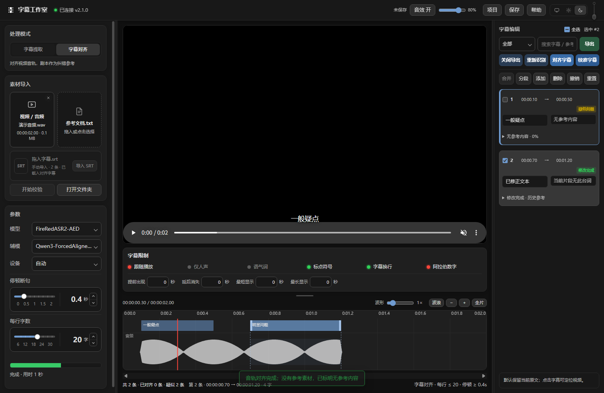

# 校准拆句与语气词标记（2026-11-07）

对应应用 2.2.0。本轮解决三件事：

- 参考里两句话被识别成一条字幕时，校准自动按参考句界拆成两条，并重新对齐时间。
- 整条只有笑声、叹气、咂嘴或填充音的字幕不再在识别阶段丢弃，而是保留并标红“语气词”；“语气词”关闭时校准自动关闭这些条目的导出，开启时正常导出。
- 工具栏顺序调整为“校准字幕 → 对齐字幕”，帮助顶部显示软件名、版本、作者邮箱和非商用声明。

## 最终界面



图为最近一次可用的界面联调截图（“校准完整句与语气标点”轮）。当时工具栏顺序为“对齐字幕 / 校准字幕”，且尚无语气词红色标签；本轮已改为“校准字幕 / 对齐字幕”并新增红色“语气词”，因会话命令执行权限受限，未能重新启动浏览器截图。

## 实现内容

### 1. 参考两句合并自动拆开

- `backend/core/calibration.py` 新增 `_reference_text(cue)`：只采纳与字幕文字逐字相同的可靠参考。
  - 高度匹配直接可信，即使采用参考后 `reference_match.stale=True` 也允许恢复句界。
  - 错字、谐音、漏字、多字要求标记未过期；歧义要求已确认候选。
  - `reference_only`、上下文异常、未匹配和旧建议不参与，避免把别处台词拼进来。
- 当参考原文含换行或句末问叹号、而字幕文字没有对应标点时，先把 `cue['text']` 恢复为参考原文，再走已有的 `_sentence_cuts` 与 `segment.segment_cue(..., split_at=...)` 拆分。
- 拆分后 `frontend/js/app.js` 的 `calibrateAll` 继续调用 `alignCalibratedCues(targets)`，对拆分出的新条目重新执行音轨对齐，并刷新缺失或过期的参考。
- 只有文字完全一致才恢复参考句界；疑似、歧义未确认或多候选内容仍按原字幕保留并提示人工复核。

### 2. 语气词保留并标红

- `backend/core/interjections.py` 新增 `mark_interjections(cues)`：所有字幕保留，命中的条目写 `interjection=True`，返回命中列表。
- `backend/core/jobs.py` 的识别任务不再调用 `drop_interjections`，改为在最终分段后标记语气词，并把 `interjections.count / cues / texts` 写入任务结果。
- `backend/core/reference_match.py` 在写入全部 `reference_match` 后执行同样的标记，保证“开始校验”后立即标红。
- 前端 `computeCueVerification` 优先识别 `cue.interjection`，返回 `{status:'suspect', obvious:true, label:'语气词'}`：
  - 徽标使用红色样式（`badge noise`）。
  - 字幕文字同时变红。
  - 提示根据“语气词”开关说明“校准会关闭此条导出”或“已开启，校准后正常导出”。
- 手动改字会清除旧的 `interjection` / `interjection_excluded` 标记；手动切换导出会清除自动排除标记，红色“语气词”保留并在悬浮提示中说明人工决定；重新识别和校准会按新文字重新标记。合并后的条目显示绿色“修改完成”，不再叠加旧标记。

### 3. 校准按开关控制语气词导出

- `calibration.normalize_cues()` 新增 `keep_interjections=False` 参数；`POST /api/segment` 的 `mode=calibration` 接收该字段。
- 关闭“语气词”（默认）：
  - 整条语气词写 `exclude_export=True`，并记 `interjection_excluded=True`。
  - 返回 `interjection_excluded` 条数，前端提示“语气词关闭导出 N 条”。
- 开启“语气词”：
  - 只撤销此前由校准自动关闭的条目，恢复导出并清除 `interjection_excluded`。
  - 返回 `interjection_restored` 条数，前端提示“语气词恢复导出 N 条”。
- 人工决定优先：`review_decision='non_script'`、用户手动关闭导出或手动改字后的条目不会被自动恢复；`review_decision='included'` 也不会被自动关闭。
- 自动排除的条目仍显示红色“语气词”，方便在导出前复核；手动“开启导出”后校准不再自动关闭，红色标记保留到改字、合并或重新识别，悬浮提示会注明“已手动开启导出”。

### 4. 设置迁移与接口兼容

- 前端设置由旧的 `dropInterjections`（勾选=丢弃）迁移为 `keepInterjections`（勾选=保留并正常导出）。
- `normalizeSettings()` 在旧字段存在且新字段为空时按 `keepInterjections = dropInterjections === false` 迁移，然后删除旧字段。
- 本地设置、工程设置和 `config/ui.json` 均已切换到新键；`config/ui.json` 使用 `keepInterjections: false` 保持原先“过滤整条语气词”的默认效果。
- `POST /api/jobs` 首选 `keep_interjections`；仍接受旧 `drop_interjections`，并按相反语义转换。
- 任务状态 `to_dict()` 返回 `keep_interjections`，便于排查前后端设置不一致。

### 5. 界面顺序、版本与帮助信息

- 处理排按钮顺序改为“关闭导出、重新识别、校准字幕、对齐字幕”；提取模式隐藏后两项。
- 校准提示补充“分句 N 处”“语气词关闭/恢复导出 N 条”。
- 右侧模式提示和帮助使用流程统一为“开始校验 → 校准字幕 → 对齐字幕”。
- 应用版本 `VERSION`、打包清单、发布工具和回归记录统一升到 `2.2.0`。`PACKAGE_MANIFEST.json` 本轮只更新版本字段；文件哈希需在下次运行 `tools/package_release.py` 打包时重新生成。
- 帮助对话框顶部新增：
  - 软件名“字幕工作室”；
  - 当前版本（优先读取 `/api/health` 的 `version`）；
  - 作者邮箱 `weieouer@gmail.com`；
  - “未经授权不得商用”声明。

### 6. 测试同步

- `tests/test_calibration.py`：新增“参考两句合并、字幕无标点时自动拆条”（覆盖句末标点和换行两种参考写法）与“语气词校准关闭/恢复导出、手动不导出不被覆盖”。
- `tests/test_interjections.py`：新增 `mark_interjections` 保留全部字幕、只标记整条语气词的用例。
- `tests/test_regressions.py`：识别任务改为保留并标记语气词；断言 `keep_interjections` 字段和旧 `drop_interjections` 兼容。
- `tests/frontend_regressions.mjs`：新增旧设置迁移、红色“语气词”校验、校准请求携带 `keep_interjections` 及导出计数聚合用例。
- `tests/browser_smoke.py`：语气词开关断言改为默认关闭、点击后持久化 `keepInterjections=true`，悬浮提示仍包含“笑声”。

## 涉及文件

- `backend/app.py`
- `backend/core/calibration.py`
- `backend/core/interjections.py`
- `backend/core/jobs.py`
- `backend/core/reference_match.py`
- `frontend/index.html`
- `frontend/js/app.js`
- `frontend/css/style.css`
- `config/ui.json`
- `PACKAGE_MANIFEST.json`
- `tools/package_release.py`
- `tests/run_backend_checks.py`
- `tests/test_calibration.py`
- `tests/test_interjections.py`
- `tests/test_regressions.py`
- `tests/frontend_regressions.mjs`
- `tests/browser_smoke.py`

## 验证状态

- 后端：当前 253 项（19 个测试文件）。最近保存的 `后端回归.json` 为 249 项全部通过；本轮新增 3 项、修改语气词与识别任务断言，尚未复跑。
- 前端：当前 78 项。最近保存的通过记录为 71 项；本轮新增 3 项（旧设置迁移、红色“语气词”校验、校准请求字段与计数聚合），连同上一轮未复跑的 4 项，较最近保存记录多 7 项，尚未复跑。
- 浏览器：当前 54 项。上一轮 54 项通过；本轮只更新语气词开关断言，尚未复跑。
- 本次会话的 PowerShell/诊断工具被权限模式拦截（提示 `Auto mode is unavailable`），无法启动 Python、Node 或 Chrome，因此以上数字不能记作通过。切换到可执行命令的权限模式后，在项目根目录运行：

```powershell
.\.venv\Scripts\python.exe tests\run_backend_checks.py
node --input-type=module -e "import fs from 'node:fs/promises'; import {runFrontendTests} from './tests/frontend_regressions.mjs'; const r=await runFrontendTests(await fs.readFile('frontend/js/app.js','utf8')); console.log(JSON.stringify({total:r.results.length,all_passed:r.all_passed})); if(!r.all_passed) process.exit(1)"
.\.venv\Scripts\python.exe tests\serve_fixture.py
.\.venv\Scripts\python.exe tests\browser_smoke.py --url http://127.0.0.1:<实际端口>
```

## 需要重启

本轮修改了 `backend/app.py`、`backend/core/calibration.py`、`interjections.py`、`jobs.py` 和 `reference_match.py`。保存工程并结束当前任务后，重启后台服务并刷新页面，新的校准拆句、语气词标记和导出控制才会生效。仅刷新页面不会加载新的后端代码。
