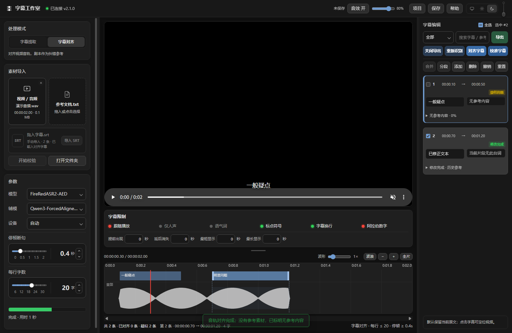

# 校准文案与音轨闭环（2026-11-07）

对应应用 2.1.0。目标是把字幕的“时间”和“内容”彻底分开：

- **对齐字幕只处理时间**：不做剧本参考校验，按音轨更新起止时间；按“停顿断句”阈值拆出独立字幕条（0 秒关闭、不参与）；不按“每行字数”拆条、不合并碎片、不改字词内容。
- **校准字幕主要按参考补全或删除**：对可靠参考直接采用参考文字，漏字补回、多余内容删除，并修正错字和谐音；再按“每行字数”分段；停顿拆条只由对齐负责，校准只用停顿判断两条相邻是否像同一句被拆开；按“标点符号”开关保留问叹号或全部去标点；数字开关同步校准后的编辑、预览和导出。
- 提前、延后、最短、最长属于对齐时间轴的显示长度设置，作用于对齐音轨和预览；0 为关闭，不写回导出时间。
- 校准发现疑似拆出的单字、双字碎片时，只显示红色“建议合并”，不自动合并。用户多选两条或多条连续相邻字幕后点“合并”，文字按从前到后的顺序直接拼接，时间取第一条开始到最后一条结束。

## 最终界面



图为最近一次界面联调截图（2026-11-07，校准完整句轮）。本轮调整的是对齐/校准职责和界面文案，没有重新截图；修改过程中的工具栏迭代图、波形对比图不收录。

## 实现内容

### 1. 对齐只校时

- `backend/core/jobs.py`：`task='align'` 时只调用 `split_on_gaps`（仅当 `gap_seconds > 0`，宽度参数传无限大以避免“每行字数”影响停顿切点），不调用 `segment_cues`、不调用 `repair_fragments`。因此对齐不会按每行字数拆条，也不会自动合并碎片。手动修改“停顿断句”触发的“仅按停顿”重分同样忽略每行字数。
- 对齐内部重新校时（校准流程）固定传 `gap_seconds=0`，不会重复拆条。
- 拆分出的子条由 `inherit_reference` 继承父条参考区间（仅元数据，不参与时间计算）；未拆条目的文字、时间和校验标签不变。对齐任务不传入参考文档、不运行 `matchScript`，不做参考校验。
- `frontend/js/app.js`：`alignAndVerify` 只启动一次对齐任务，不再触发剧本校验；完成提示明确“只更新起止时间、按停顿拆条、未按字数拆条、未改字词内容”。
- `backend/core/jobs.py` 的任务名称由“对齐并校验”改为“对齐字幕”；界面提示和页脚不再声称对齐会给出剧本参考建议，参考核对统一指向“开始校验”。

### 2. 校准管内容

- **校准的首要动作是按参考补全或删除**：对状态为高度匹配、错字、谐音、漏字、多字的可靠参考，`frontend/js/app.js` 的 `calibrateAll` 直接采用参考文字，漏字补回、多字删除；上下文明显不符、未匹配、未确认歧义不采用。原 ASR、原始起止时间保留，改动后可撤销。
- `backend/core/calibration.py`：
  - 可靠同字参考补回标点后，按 `keep_punc` 选择保留问叹号（开启）或去掉全部标点（关闭）。
  - 明确句界先独立拆条，再按每行字数整理；停顿阈值只用于判断“建议合并”证据，不在校准内拆条。
  - 对最终布局检测单字/双字碎片，写入 `merge_suggestion`，返回 `merge_suggestions`、`merge_suggestion_pairs` 和 `suggested_indices`；`merged` 固定为 0。
  - 碎片建议需要完整词跨界、共同原句或同句相邻可靠参考证据；手动拆分、导出状态不一致、对齐错误、明确句界等不加建议。
- `backend/app.py`：`/api/segment` 的 `mode=calibration` 接收 `keep_punc`。
- `backend/core/srt_io.py`：抽出 `strip_subtitle_punctuation`，与导出时的去标点规则共用，保护数字、单位和英文词内部符号。
- `frontend/js/app.js`：校准请求携带 `keep_punc`；完成提示显示分句数、“建议合并”数量，以及其中按参考补全和删除的条数。

### 3. 红色建议合并与多选合并

- 碎片条文字显示为红色，并显示红色“建议合并”徽标和原因提示；低筛选条件下仍保留该条，便于复核。
- 合并按钮支持两条或多条**连续相邻**字幕；非连续多选拒绝并提示。
- 合并后文字按原顺序拼接，时间取第一条开始到最后一条结束；合并全部 ASR 来源，清除合并处和相邻条目的旧建议，整批可一次撤销。
- 编辑文字、改时间、分段、删除、关闭导出、重新识别、重新校准等操作会清除过期建议。

## 涉及文件

- `backend/core/jobs.py`
- `backend/core/calibration.py`
- `backend/core/srt_io.py`
- `backend/app.py`
- `frontend/js/app.js`
- `frontend/index.html`
- `frontend/css/style.css`
- `tests/test_pauses.py`
- `tests/test_calibration.py`
- `tests/test_regressions.py`
- `tests/frontend_regressions.mjs`
- `tests/browser_smoke.py`

## 验证状态

- 前端回归：当前 `tests/frontend_regressions.mjs` 共 75 项，新增“多选合并按顺序拼接并跨首尾时间”“拒绝非连续多选合并”“红色建议合并计入待复核”“按参考补全漏字并删除多余字”等用例。已保存的 [前端回归.json](前端回归.json) 为上一版 71 项全部通过，尚未覆盖本轮新增的4项，因此不能把当前75项记作已通过。
- 后端回归：`tests/test_pauses.py` 已改为验证“对齐按停顿拆条、0秒关闭、不按宽度拆条、不自动合并”；`tests/test_calibration.py` 增加 `keep_punc=False` 去标点断言和“停顿拆条归对齐、校准不按停顿拆条”用例。当前共 250 项用例（最近保存的 `后端回归.json` 为 249 项全部通过，新增 1 项未复跑）。
- 浏览器联调：`tests/browser_smoke.py` 已改为“校准后碎片红色建议合并 → 多选0、1条合并 → 文字为‘中毒的人’、时间为第一条开始到最后一条结束 → 导出/去标点 → 两次撤销回到校准前”；无剧本对齐用例改为直接执行、不弹参考确认，并断言只改时间且参考匹配状态不变。当前仍为 54 项用例，但本轮未复跑。
- 本次会话的 PowerShell/诊断工具被权限模式拦截（提示 `Auto mode is unavailable`），无法启动 Python、Node 或 Chrome，因此后两项以及最新前端套件都没有执行结果。切换到可执行命令的权限模式后，在项目根目录运行：

```powershell
.\.venv\Scripts\python.exe tests\run_backend_checks.py
node --input-type=module -e "import fs from 'node:fs/promises'; import {runFrontendTests} from './tests/frontend_regressions.mjs'; const r=await runFrontendTests(await fs.readFile('frontend/js/app.js','utf8')); console.log(JSON.stringify({total:r.results.length,all_passed:r.all_passed})); if(!r.all_passed) process.exit(1)"
.\.venv\Scripts\python.exe tests\serve_fixture.py
.\.venv\Scripts\python.exe tests\browser_smoke.py --url http://127.0.0.1:<实际端口>
```

## 需要重启

本轮修改了 `backend/core/jobs.py`、`calibration.py`、`srt_io.py` 和 `app.py`。保存工程并结束当前任务后，重启后台服务并刷新页面，新的对齐/校准行为才会生效。
